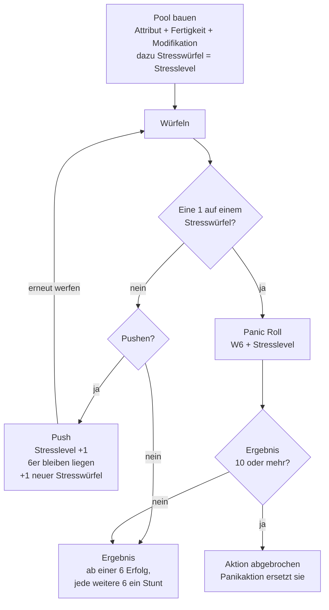
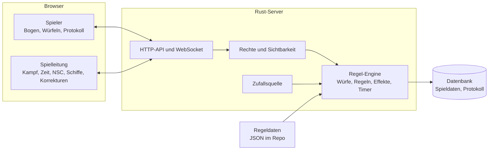
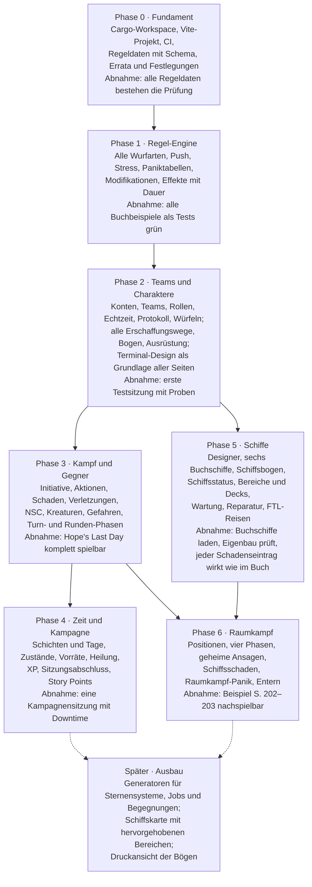

# Xenoforge – Projektplan

Begleit-App für das ALIEN RPG (Free League, Grundregelwerk 1. Auflage). Stand: 3. November 2026.

## 1. Ziel und Rahmen

Die App begleitet eine ALIEN-RPG-Spielrunde am Tisch. Charakterbögen, Würfe, Kämpfe, Schiffe und die Spielzeit laufen digital, Karte und Figuren bleiben auf dem Tisch. Grundsatz: **Die App rechnet, die Spielleitung entscheidet.** Jedes automatische Ergebnis lässt sich von der Spielleitung korrigieren, und jede Korrektur wird protokolliert.

| Modul | Wer nutzt es | Kern |
| --- | --- | --- |
| Charaktermanager | Spieler, Spielleitung | Erschaffung nach allen Methoden des Buchs (auch Androiden), Ausrüstung mit Traglast und Vorräten, Weiterentwicklung über XP |
| Proben und Kampf | Spieler, Spielleitung | Würfe per Klick mit Push, Stress und Panik; Kampf mit Initiative, Aktionen, Schaden, kritischen Verletzungen; Gegner, NSC und Kreaturen |
| Schiffsdesigner | Spielleitung, Spieler | Neue Schiffe nach den Bauregeln, vorgefertigte Schiffe aus dem Buch laden |
| Raumkampf | Spielleitung, Spieler | Charaktere auf Schiffspositionen setzen, Raumkampf nach den Regeln des Buchs |
| Zeitmanagement | Spielleitung | Spielzeit in Schritten: Schichten, darin Turns und Runden; daran hängende Timer laufen mit |

Quer über alle Module liegen die **Regel-Engine** (Würfel und Regelprüfungen), das gemeinsame **Spielprotokoll**, das alle live sehen, und die **Spielzeit** in Schritten.

Beide Spielmodi des Buchs werden unterstützt: **Cinematic** (Einzelszenario in Akten, vorgefertigte Charaktere, Story Points) und **Campaign** (fortlaufende Kampagne, selbst erschaffene Charaktere, XP).

Bewusst nicht enthalten:

- Spielfeld, Karte, Positionen und Bewegung. Zone und Reichweite gibt die Person beim Wurf an (z. B. „Ziel auf Medium“), die App rechnet nicht nach. An Bord kennt die App nur grobe Bereiche wie „Brücke, Deck 1“, ohne Entfernungen (7.5).
- Regeln aus Erweiterungen, Szenariobänden oder späteren Ausgaben.
- Wörtlicher Buchtext und Bilder (das Repo ist öffentlich, siehe Abschnitt 2).
- Sternensystem-, Job- und Begegnungsgeneratoren aus Kapitel 12. Sie kommen später als Ausbaustufe (Abschnitt 12).

## 2. Regelgrundlage

Verbindlich ist ausschließlich das **ALIEN RPG Core Rulebook, Free League, 1. Auflage 2019** (englisch, ISBN 978-91-88805-55-3). Alle Seitenangaben im Plan und im Code sind die gedruckten Buchseiten. Sie liegen vier Seiten unter der PDF-Seitenzahl.

**Regel-Spezifikation.** Das Buch ist in sieben Teilen ausgewertet: Charaktere, Würfel und Panik, Kampf, Gefahren und Ausrüstung, Schiffe und Raumkampf, Kreaturen, Spielleitung und Kampagne. Jede Regel steht dort mit Seitenangabe, jede Tabelle vollständig mit allen Zahlenwerten. Diese Dateien liegen unter [`docs/rules/`](rules/) und sind die Referenz für Code und Tests. Wo Errata oder Festlegungen unten etwas anderes sagen, gilt [`docs/rules/00-errata-und-festlegungen.md`](rules/00-errata-und-festlegungen.md).

**Regeln als Daten.** Karrieren, Talente, Waffen, Ausrüstung, Tabellen (Panik, kritische Verletzungen, Angriffe der Kreaturen), Schiffsmodule und vorgefertigte Schiffe liegen als versionierte Datendateien vor, jeder Eintrag mit Seitenangabe. Die Engine liest diese Daten; Zahlen werden nicht im Code verstreut.

**Öffentliches Repo.** Alle Zahlenwerte aus dem Buch werden übernommen, denn ohne sie funktioniert das Werkzeug nicht. Beschreibungen sind eigene Kurzformulierungen mit Seitenverweis; wörtliche Buchpassagen, Bilder und Flufftext kommen nicht ins Repo.

**Offizielle Errata.** Free League hat Korrekturen zum ersten Druck veröffentlicht, die im zweiten Druck und im aktuellen PDF umgesetzt sind. Sie gelten in Xenoforge und gehen der Spezifikation vor:

| Seite | Korrektur |
| --- | --- |
| 51 | Pilot: Schlüsselfertigkeiten sind Piloting, Ranged Combat und Comtech |
| 88 | Fahrzeug betreten oder verlassen ist eine schnelle Aktion, keine langsame |
| 119–124 | Bei M4A3, M41A, M42A und M41AE2 gelten die Werte der Waffentabellen, nicht die der Infografiken |
| 192 | In der Aktionsübersicht des Raumkampfs kommt Maneuver dazu, Evade entfällt; maßgeblich sind die Beschreibungen auf S. 193 |
| 291 | Im Schleichmodus bewegt sich ein Xenomorph zwei Zonen pro Punkt Speed und Turn; Menschen zwei Zonen, also Speed 1 |

Die Korrekturen an der Sternenkarte betreffen die App nicht.

**Widersprüche und Lücken.** Darüber hinaus hat die Auswertung über 200 Stellen gefunden, an denen das Buch sich widerspricht, etwas offen lässt oder der Spielleitung die Entscheidung gibt. Dafür gibt es einen **Regelentscheidungs-Katalog**: Jede Stelle hat eine ID, die Seite, einen Standard und, wo sinnvoll, eine Alternative, die die Spielleitung pro Team umschalten kann. Standard ist „wie gedruckt“, außer bei offensichtlichen Druckfehlern. Bereits festgelegt:

| Stelle | Problem im Buch | Festlegung |
| --- | --- | --- |
| Trauma-Probe nach der Sitzung [S. 104] | Trauma entsteht laut Text, wenn die EMPATHY-Probe **gelingt** | Trauma entsteht, wenn die Probe **misslingt**, wie in FAQ und späteren Ausgaben klargestellt. Die Schwelle bleibt 13+ wie in der 1. Auflage |
| Antriebsschaden „Displacement drive malfunction“ [S. 198] | „FTL-Rating halbiert“ würde das Schiff schneller machen | Rating wird verdoppelt |
| Signature Attacks [S. 291 ff.] | Offen, ob weitere Erfolge mehr Schaden machen | +1 Schaden je weiterem Erfolg |
| Transponder [S. 190, 196] | S. 190: sofort beschießbar; S. 196: jeder Schuss braucht Target Lock | Eingeschalteter Transponder ersetzt das Target Lock |
| Evade [S. 196] | Fire Weapon erwähnt Evade noch, das laut Errata keine Aktion mehr ist | Evade gibt es nicht |
| Story Points [S. 61, 389] | Nur für Cinematic beschrieben, aber Kästchen auf dem Bogen; offen, ob mehrere pro Wurf | Nur Cinematic; einer pro Wurf, nur für Fertigkeitsproben |
| Gnadenstoß [S. 99] | Verweist auf das Talent „Cold-Blooded“, das es nicht gibt | Gilt für Merciless [S. 78] |
| Motor starten [S. 88, 113] | Tabelle: langsam; Text auf S. 113: schnell. Die Errata nennt nur Ein- und Aussteigen | Wie Tabelle (langsam), Alternative schnell |
| Vorratswurf mit Calm Breather / Light Eater [S. 34, 78] | Offen, ob „max. 6 Würfel“ vor oder nach „−2 Würfel“ gilt | Würfel = max(1, min(Vorrat, 6) − 2) |
| Dunkelheit [S. 83, 95] | Zone „Dark“ (−2) wird als schwach beleuchtet beschrieben; die Fernkampftabelle kennt „Dim light“ −1 und „Darkness“ −2 | Lichtstufe einmal wählen; Zone „Dark“ zählt als Darkness −2, nie doppelt |

Den vollständigen Katalog baut Phase 0 aus den Abschnitten „Ambiguities“ der Spezifikation auf.

## 3. Rollen und Rechte

Jede Person hat ein Benutzerkonto. Gespielt wird in **Teams**: Die Spielleitung (im Buch „Game Mother“) legt ein Team an, lädt Spieler per Einladungslink ein und ordnet ihm Charaktere zu. Ein Team ist entweder ein **Szenario** (Cinematic) oder eine **Kampagne** (Campaign) und bündelt Mitglieder, Charaktere, NSC, Schiffe, Spielzeit und Protokoll. Die Rolle hängt am Team, nicht am Konto: Wer in einem Team Spielleitung ist, kann in einem anderen Spieler sein. Den Begriff „Team“ nutzt der Plan auch, damit er nicht mit der Kampfrunde verwechselt wird.

| Bereich | Spielleitung | Spieler |
| --- | --- | --- |
| Charaktere | Im eigenen Team alle sehen und ändern; Charaktere der Mitglieder dem Team zuordnen oder aus ihm lösen | Eigene Charaktere jederzeit anlegen und verwalten, auch ohne Team; die Bögen der anderen sehen sie nicht |
| Persönliche Agenda | Alle sehen; in Cinematic pro Akt neu verteilen [S. 31, 216] | Nur die eigene sehen [S. 213]; in Campaign gibt die App alle Agenden beim Sitzungsabschluss für die gemeinsame XP-Runde frei [S. 31] |
| Verdeckter Android | Weiß Bescheid | Nur der eigene Charakter; die Enthüllung löst bei Anwesenden Stress aus [S. 103] |
| NSC und Kreaturen | Anlegen, Werte sehen, würfeln | Sehen nur Namen und Wirkungen, keine Werte |
| Würfe | Würfe für NSC und Kreaturen öffentlich oder verdeckt | Immer offen, denn über den Push entscheidet, wer das Ergebnis sieht [S. 60]. Ergebnisse stehen im gemeinsamen Protokoll |
| Kampf und Raumkampf | Starten, Reihenfolge führen, Gegner steuern, beenden | Eigene Aktionen ausführen, wenn sie dran sind |
| Spielzeit | Schritte weiterschalten, Phasen öffnen und schließen | Sehen |
| Schiffsstatus | Schäden setzen, Systeme ändern, Bereiche bearbeiten | Sehen, ohne Geheimes |
| Aufenthaltsort an Bord | Für alle setzen | Für den eigenen Charakter setzen |
| XP (Campaign) | Fragen nach der Sitzung abschließen, letztes Wort [S. 35] | Antworten vorschlagen, XP zwischen Sitzungen ausgeben [S. 36] |
| Story Points (Cinematic) | Am Aktende vergeben, ohne Begründung [S. 216] | Ausgeben; sie gehören der **Person**, nicht dem Charakter, max. 3 [S. 383] |
| Korrekturen | Jeden Wert überschreiben, wird protokolliert | Keine an Ergebnissen |

Sonderfälle aus dem Buch:

- **Vorgefertigte Charaktere (Cinematic):** Übrige Charaktere werden NSC unter der Spielleitung [S. 26].
- **PvP (Cinematic):** Die Spielleitung „ruft PvP aus“. Danach wechselt der abtrünnige Charakter zur Spielleitung, und die Person bekommt einen freien Charakter, falls einer übrig ist [S. 32].
- **Tod eines Charakters:** Die Spielleitung kann der Person einen übrigen Charakter oder NSC übergeben [S. 101]. Story Points bleiben bei der Person.
- **NSC folgen vereinfachten Regeln:** Sie pushen nie, haben keinen Stress und würfeln keine Panik. Die Spielleitung würfelt für sie nur, wenn sie direkt auf einen Spielercharakter wirken [S. 62, 105, 214]. Die App bietet NSC-Würfe deshalb nur für solche Aktionen an.
- **Geheime Notiz an die Spielleitung:** Spieler können der Spielleitung privat schreiben, wie es das Buch für Agenden und Geheimnisse empfiehlt [S. 213].

### 3.1 Lagebild der Spielleitung

Eine Seite zeigt der Spielleitung alles Wichtige auf einen Blick, sortiert nach Dringlichkeit:

1. Was Leben bedroht, dann Einschränkungen, dann Hinweise, dann reine Infos (Stufen AUTO, HINWEIS, INFO aus 7.4).
2. Wer ist wo, mit Sprechgruppen.
3. Werte der Crew: Health, Stress, Panik, Zustände.
4. Was demnächst abläuft, zum Beispiel Notreparaturen oder Timer.
5. Offene Reparaturen mit Proben und Ersatzteilen.

Das Lagebild liest nur vorhandene Daten und rechnet nichts selbst. Es wächst mit den Phasen: Crew ab Phase 2, Kampf ab Phase 3, Zeit ab Phase 4, Schiff ab Phase 5. Spieler sehen den Schiffsstatus ebenfalls, aber ohne Geheimes wie versteckte Kreaturen, geheime Timer oder NSC-Werte.

```
┌─ LAGE · LYSSA ──────────────────────────── TURN 14 · SCHICHT 2 · TAG 3 ┐
│ ▲▲ LEBENSERHALTUNG AUS   OHNE DRUCKANZUG: FREEZING, STAMINA/SCHICHT AUTO│
│ ▲▲ REAKTORLECK           REAKTORBEREICH: 1 RAD PRO SCHICHT         AUTO│
│ ▲  BORDSPRECHANLAGE AUS  SPRECHEN NUR IM BEREICH, BORDCOMPUTER  HINWEIS│
│                          NUR AM TERMINAL                               │
│ ▲  LEITERN BESCHÄDIGT    DECKWECHSEL NUR MIT MOBILITY-PROBE        AUTO│
│ ·  KAFFEEMASCHINE AUS                                              INFO│
├─ WER IST WO ─────────────────────────────────────────── SPRECHGRUPPE ─┤
│ DECK 1  BRÜCKE         ORTIZ (CAPTAIN) · KAPLAN (PILOT)            A  │
│ DECK 2  MASCHINENRAUM  REYES (ENGINEER)  ☢ 2 RADS                   B  │
│ DECK 2  LADERAUM       NAKAMURA · [DRONE, NUR SPIELLEITUNG]         C  │
│ FUNK    REYES ↔ NAKAMURA (EIGENE FUNKGERÄTE)                          │
├─ CREW ─────────────────────────────────────────────────────────────────┤
│ ORTIZ  HEALTH 3/4  STRESS 2        KAPLAN  HEALTH 4/4  STRESS 4 PANIK 8│
├─ LÄUFT AB ─────────────────────────────────────────────────────────────┤
│ ANDOCKBUCHT NOTREPARIERT   NOCH 1 SCHICHT                              │
├─ REPARATUR ────────────────────────────────────────────────────────────┤
│ LEBENSERHALTUNG   HEAVY MACHINERY · 1 TEIL MECHANISCH (AN BORD: 3)     │
└────────────────────────────────────────────────────────────────────────┘
```

## 4. Regel-Engine

Alle Module würfeln und rechnen über eine gemeinsame Regel-Engine. Sie ist eine eigenständige Bibliothek ohne Oberfläche und Datenbank: Sie bekommt Spielzustand, Befehl und Zufallsquelle und liefert Ereignisse zurück (Würfelergebnis, Stress +1, Panik, Schaden). Gewürfelt wird **auf dem Server**, damit alle dasselbe Ergebnis sehen und niemand nachwürfeln kann. In Tests läuft die Engine mit festem Zufallswert und ist damit reproduzierbar.

### 4.1 Wurfarten

Das Buch kennt deutlich mehr als die normale Fertigkeitsprobe. Jede Wurfart ist ein eigener Typ mit eigenen Regeln:

| Wurfart | Würfel | Stresswürfel | Pushen | Eine 1 auf Stresswürfel | Seite |
| --- | --- | --- | --- | --- | --- |
| Fertigkeitsprobe | Attribut + Fertigkeit + Modifikation | ja, = Stresslevel | einmal, mit Talent zweimal | Panic Roll, kein Push | 58–61 |
| Nur Attribut (z. B. Talent lernen, Trauma) | Attribut | offen, Katalog | offen, Katalog | – | 36, 104 |
| Gnadenstoß | EMPATHY | nein | offen | – | 99 |
| Death Roll | STAMINA | nein | nein | – | 99 |
| Rüstung / Deckung | Grundwürfel = Armor Rating; jeder Erfolg = −1 Schaden | nein | nein | – | 96, 98 |
| Vorratswurf (Air, Food, Water, Power) | Stresswürfel = Vorrat, max. 6 | – | nein | Vorrat −1, **keine** Panik | 34 |
| Strahlung | Würfel = aktuelle Rads; jeder Erfolg = 1 Schaden | – | – | – | 110 |
| Einzelner Stresswürfel (permanente Rads, Epilepsie, Ei öffnet sich) | 1 Stresswürfel | – | – | löst das Ereignis aus | 110, 151, 300 |
| Fester Pool (Kreatur, MU/TH/UR, MedPod, AutoDoc, Sentry Gun) | N Grundwürfel | nein | nein | – | 64, 136 |
| Panic Roll | W6 + Stresslevel (Nerves of Steel −2) | – | – | – | 104 |
| Initiative | Karte 1–10 ziehen | – | – | – | 87 |

### 4.2 Fertigkeitsprobe Schritt für Schritt

1. **Pool bauen:** Attribut + Fertigkeit (auch 0) + Summe aller Modifikationen (Ausrüstung, Schwierigkeit, Hilfe max. +3, Talente, Effekte). Dazu Stresswürfel = Stresslevel; Androiden und NSC haben keine [S. 58–63].
2. **Negative Überhänge:** Bleiben weniger als 0 Grundwürfel, fallen Stresswürfel weg. Ohne Würfel scheitert die Probe automatisch [S. 62].
3. **Auswerten:** Erfolg ab einer 6 auf irgendeinem Würfel. Jede weitere 6 ist ein Stunt aus der Liste der Fertigkeit [S. 58].
4. **Eine 1 auf einem Stresswürfel:** Kein Push mehr, sofort Panic Roll. Bei einer Waffe mit Magazin ist es danach leer [S. 61, 96]. Ab Panikergebnis 10 wird die Aktion abgebrochen, auch bei Erfolgen [S. 104].
5. **Pushen (nur Spielercharaktere, keine Androiden, im vergleichenden Wurf nur der Angreifer):** Stresslevel +1 *vor* dem Wurf, alle 6er bleiben liegen, ein neuer Stresswürfel kommt dazu, alle übrigen Würfel werden neu geworfen. Danach wieder Schritt 3 [S. 60–61].
6. **Story Point (nur Cinematic):** Nach dem Wurf +1 automatischer Erfolg [S. 61].
7. **Ergebnis:** Einfacher Wurf, vergleichender Wurf (Gleichstand verliert der Angreifer, Stunts = Differenz − 1) oder Gruppenwurf (einer würfelt, Scheitern gilt für alle) [S. 62, 64, 70].



Der Push ist ein Kreis zurück zum Würfeln, einmal oder mit passendem Talent zweimal. Nach einer 1 auf einem Stresswürfel führt kein Weg mehr dorthin.

Wo der Wurf eine Entscheidung braucht, hält die Engine an und fragt die richtige Person: pushen ja oder nein, Story Point einsetzen, Stunts wählen, Overkill statt Panikeffekt, The Long Haul gegen alle 1er. Das Ergebnis sehen alle im Protokoll, inklusive jedes einzelnen Würfels und jeder Modifikation mit Quelle.

### 4.3 Stress und Panik

- **Panic Roll:** W6 + Stresslevel auf der Paniktabelle [S. 105], im Raumkampf auf der eigenen Raumkampf-Paniktabelle [S. 201]. Beide Tabellen sind Daten.
- **Mehr Panik:** Ein neuer Effekt ersetzt den alten. Liegt er niedriger, wird er auf eine Stufe über dem alten angehoben [S. 104].
- **Ketten:** Scream, Flee, Berserk und Overkill zwingen andere zu Panic Rolls [S. 104–105]. Weil die App keine Positionen kennt, schlägt sie alle Spielercharaktere der Szene vor, und die Spielleitung hakt ab, wer es hört oder sieht. Dasselbe gilt für „alle in SHORT range“.
- **Panik endet** durch eine erfolgreiche COMMAND-Probe eines anderen, durch Broken oder wenn ein Turn vergeht. Das erkennt die App an den Zeitschritten [S. 104].
- **Stress steigt automatisch** bei Push, Dauerfeuer, Schaden, Gnadenstoß, Angriff durch die eigene Crew, gescheiterter Analysis und Paniktabelle, bei Zuständen und Traumata über Timer. Bei Kreaturen und Schreckensmomenten entscheidet die Spielleitung; dafür gibt es „Stress ±N für ausgewählte Charaktere“ [S. 103, 211].
- **Stress sinkt** pro vollem Turn Ruhe in sicherer Umgebung, auf 0 nach einer ungestörten Schicht Ruhe (F-16), einmal pro Akt bzw. Sitzung über das Signature Item, durch Medikamente und Talente. Blockiert wird das durch Zustände wie Starving oder Freezing, Traumata und laufenden Raumkampf [S. 104, 106–107, 193].
- **Trauma-Prüfung:** Wer in einer Sitzung 13 oder mehr gewürfelt hat, wird beim Sitzungsabschluss automatisch zur EMPATHY-Probe aufgefordert. Misslingt sie, würfelt die App das Trauma auf der W6-Tabelle aus (Festlegung in Abschnitt 2) [S. 101, 104].

### 4.4 Effekte mit Dauer

Vieles im Spiel ist ein Modifikator mit Ablaufzeit: Tremble bis die Panik endet, kritische Verletzungen bis zur Heilung, Bier −1 auf WITS für eine Schicht, Naproleve-Überdosis bis Schichtende. Die Engine führt das als **Effekte** am Charakter: Quelle, betroffene Proben, Wert, Ende (Runde, Turn, Schicht, Tag, Ereignis oder manuell). Der Wurfdialog zeigt alle aktiven Effekte an, und sie laufen mit den Zeitschritten ab (9.1).

## 5. Charaktermanager

Der Charaktermanager deckt alle sieben Wege ab, auf denen im Buch Charaktere entstehen. Er prüft jeden Schritt gegen die Regeln und hält den Bogen danach im Spiel aktuell. Zufallstabellen für Charaktere gibt es im Buch nicht; gewürfelt werden nur Startgeld und Mengen wie „W6 Dosen“ [S. 26, 39–55].

### 5.0 Besitz und Teams

- **Ein Charakter gehört der Person, die ihn angelegt hat.** Spieler legen Charaktere in ihrer eigenen Sammlung an und verwalten sie dort, auch ohne Team.
- **Die Spielleitung ordnet Charaktere ihrem Team zu.** Zur Auswahl stehen die Charaktere der Team-Mitglieder. Die Spielleitung kann einen Charakter auch wieder aus dem Team lösen; sein Stand (Health, Stress, XP, Ausrüstung) bleibt dabei erhalten.
- **Höchstens ein Team gleichzeitig.** Sonst würden Health, Stress und XP doppelt geführt.
- **Vorgefertigte Szenario-Charaktere und NSC** legt die Spielleitung an. Vorgefertigte Charaktere gibt sie Spielern zum Spielen; die Spielleitung bleibt Eigentümerin.

### 5.1 Erschaffungswege

| Weg | Wer | Was die App tut | Seite |
| --- | --- | --- | --- |
| Kampagnen-Charakter | Spieler | Assistent in zehn Schritten mit Regelprüfung (5.2) | 27–36 |
| Vorgefertigter Charakter (Cinematic) | Spielleitung legt an, Spieler wählen | Auswahl im Szenario, Losentscheid bei Streit, übrige werden NSC | 26, 370–374 |
| Android | Spieler, nach Absprache in der Gruppe | Variante der beiden Wege oben (5.3) | 28–29, 111 |
| Session Zero | Gruppe | Gemeinsame Erschaffung, Wahl des Rahmens (Space Truckers, Colonial Marines, Frontier Colonists), Checkliste mit den acht Fragen | 217, 326–329 |
| Ersatzcharakter | Spielleitung | Übergibt nach Tod oder PvP einen freien Charakter oder NSC | 32, 101 |
| Schnell-NSC | Spielleitung | 14 Attributpunkte als Richtwert, max. 5 (außer Androiden), nur benötigte Fertigkeiten, dazu Name, Aussehen, Eigenschaft, Ziel | 214 |
| Typische NSC | Spielleitung | Vorlagen aus dem Buch laden und anpassen | 354–357 |

### 5.2 Assistent für Kampagnen-Charaktere

Die Reihenfolge folgt dem Buch [S. 27]. Jeder Schritt zeigt die Regel mit Seitenzahl und lässt erst weiter, wenn er gültig ist.

1. **Karriere** aus neun: Colonial Marine, Colonial Marshal, Company Agent, Kid, Medic, Officer, Pilot, Roughneck, Scientist. Sie legt Schlüsselattribut, drei Schlüsselfertigkeiten, drei Karrieretalente, Ausrüstungsliste und Geldformel fest [S. 38–55].
2. **Attribute:** 14 Punkte, jedes 2 bis 4, das Schlüsselattribut bis 5 [S. 28].
3. **Fertigkeiten:** 10 Punkte, Schlüsselfertigkeiten bis 3, alle anderen höchstens 1 [S. 28].
4. **Talent:** genau eines der drei Karrieretalente [S. 29].
5. **Name** aus den Vorschlägen der Karriere oder frei; **Aussehen** in wenigen Worten [S. 30].
6. **Persönliche Agenda:** einer der drei Vorschläge oder eigene, im Spiel nur für Spieler und Spielleitung sichtbar, beim Sitzungsabschluss für die Gruppe [S. 31, 213].
7. **Buddy und Rival:** je ein anderer Spielercharakter, nicht derselbe. Bei zu kleiner Gruppe bleibt das Feld leer [S. 31].
8. **Ausrüstung:** zwei Gegenstände aus zwei verschiedenen „A oder B“-Zeilen der Karriere. Jede Waffe bekommt zwei volle Magazine extra, „W6 Dosen“ wird gewürfelt, Kleidung ist frei [S. 33]. Dazu ein **Signature Item**, meist winzig.
9. **Startgeld** wird gewürfelt und protokolliert: Kid $W6, Company Agent und Officer $2W6×100, alle anderen $W6×100 [S. 39–55].
10. **Abgeleitete Werte:** Health = STRENGTH (Tough +2), Stresslevel 0, Traglast = STRENGTH × 2 [S. 30, 34].

### 5.3 Androiden

Ein Android ist ein Schalter am Charakter, kein eigener Charaktertyp. Er wirkt in fast jedes Modul hinein:

| Bereich | Regel für Androiden | Seite |
| --- | --- | --- |
| Erschaffung | Nach den 14 Punkten +3 auf zwei verschiedene Attribute, diese bis 8; kein Signature Item nötig | 28–29 |
| Proben | Kein Stresslevel, keine Stresswürfel, kein Pushen, keine Panik, deshalb nie leeres Magazin | 29, 96, 111 |
| Schaden | Bei Broken eigene W6-Tabelle für kritische Schäden; doppeltes Ergebnis rutscht eine Zeile tiefer; handelt weiter bis System Shutdown; keine Death Rolls | 111 |
| Reparatur statt Heilung | Eine Schicht Arbeit und eine COMTECH-Probe stellen alles wieder her, auch selbst. Nach Shutdown erst reaktivieren (Strom, ein Turn, COMTECH), danach dauerhaftes Trauma | 111 |
| Vorräte und Zustände | Braucht weder Luft noch Nahrung, Wasser oder Schlaf; immun gegen Vakuum, Kälte, Krankheit | 111 |
| Entwicklung | XP-Frage „Panic Roll gemacht?“ entfällt; Talente, die nur Stress oder Push betreffen, markiert der Assistent als wirkungslos | 35 |
| Verdeckt | Kann sich als Mensch ausgeben; bei Enthüllung bekommen Menschen in der Nähe Stress +1 | 103 |

### 5.4 Ausrüstung und Traglast

- **Katalog** mit allen Gegenständen aus Kapitel 6: Waffen, Rüstungen, Geräte, Medikamente, Nahrung, Fahrzeuge, jeweils mit Gewicht, Preis, Bonus auf Fertigkeit und Vorratswert. Dazu **freie Gegenstände**, denn NSC und Szenarien nennen Ausrüstung, die nicht im Katalog steht.
- **Gewicht** 0 (winzig), ¼, ½, 1, 2, 3 oder 4. Traglast normal STRENGTH × 2. Bis STRENGTH × 4 ist überladen erlaubt; dann verlangt Rennen oder Kriechen im Kampf eine MOBILITY-Probe. Mehr geht nicht [S. 34]. Food und Water zählen als aufgerundet Vorrat ÷ 4 Gegenstände [S. 34–35].
- **Ort** pro Gegenstand: am Körper, im Schiff, im Lager. Was nicht am Körper ist, steht im Wurfdialog nicht zur Verfügung [S. 33].
- **Waffen:** Magazin geladen oder leer, Zahl der Reserve-Magazine. Nachladen ist eine langsame Aktion [S. 96].
- **Geräte mit Vorrat** wie Bewegungsmelder, Schneidbrenner, Stun Baton oder XM99A verlangen nach jeder Nutzung einen Power-Wurf; Rüstungen tragen ihren Air-Vorrat.
- **Bonus im Wurf:** Wer würfelt, bekommt passende Gegenstände zum Zuschalten angeboten (z. B. Electronic Tools +1 auf COMTECH).
- **Verbrauch:** Medikamente und Nahrung haben Dosen; ihre Wirkung wird beim Benutzen als Effekt gesetzt (Naproleve: Stresslevel auf 0) [S. 136–139].
- **Gruppenbesitz:** Fahrzeuge, Schiffe und auf Wunsch Vorräte gehören der Gruppe [S. 33–34].
- **Geld:** eigenes Feld mit Buchungsliste, obwohl der gedruckte Bogen keines hat.

### 5.5 Vorräte

Air, Food, Water und Power werden nur verfolgt, wenn die Spielleitung die Lage als knapp markiert [S. 34]. Dann fordert die App die Vorratswürfe bei den passenden Zeitschritten an: Air jeden Turn und nach jeder Anstrengung, Water täglich und nach Anstrengung, Food täglich, Power je nach Gerät [S. 35]. Bei Air 0 beginnt sofort das Ersticken [S. 110]. Bei Food oder Water 0 startet ein Tageszähler; nach einem Tag ohne ausreichend Nahrung oder Wasser setzt die App Starving bzw. Dehydrated [S. 106].

### 5.6 Laufende Werte auf dem Bogen

Health, Stresslevel, Strahlung (vorübergehend und dauerhaft), kritische Verletzungen mit Timern, Zustände (Starving, Dehydrated, Exhausted, Freezing), Traumata, aktive Effekte, Vorräte, XP und Story Points. Der Bogen enthält alle Felder des Originalbogens [S. 389] und hat keine künstliche Grenze von zehn Zeilen; ein Android mit STRENGTH 8 trägt 16 Gegenstände.

### 5.7 Weiterentwicklung

**Campaign.** Beim Sitzungsabschluss beantwortet die Gruppe die neun XP-Fragen, je Frage 1 XP, höchstens 9; die Spielleitung hat das letzte Wort [S. 35]. Was die App weiß, füllt sie vor: Teilnahme, ob ein Panic Roll gewürfelt wurde, ob Geld verdient wurde.

XP werden nur in der Phase „zwischen den Sitzungen“ ausgegeben [S. 36]:

| Kauf | Kosten | Bedingung |
| --- | --- | --- |
| Fertigkeit +1 | 5 XP | Höchstens Stufe 5 |
| Neue Fertigkeit (0 → 1) | 5 XP | In der Sitzung ohne Fertigkeit erfolgreich benutzt (prüft das Protokoll) oder eine Schicht Unterricht bei jemandem mit Stufe 1+ |
| Talent | 5 XP | Ein Tag Übung und WITS-Probe, ein Versuch pro Tag; mit Lehrer, der das Talent hat, automatisch. Karrieretalente nur für die eigene Karriere. Like the Back of Your Hand und Weapon Specialist mehrfach |

Attribute steigen nie. Buddy und Rival dürfen nach jeder Sitzung wechseln [S. 36].

**Cinematic.** Story Points gehören der Person, höchstens 3, und wandern ins nächste Szenario mit [S. 61, 383].

## 6. Proben, Kampf und Gegner

Spieler würfeln per Klick vom eigenen Bogen aus. Die Spielleitung führt Kämpfe als Rundenablauf mit Initiativkarten und Aktionsbudget; Schaden, kritische Verletzungen und Death Rolls rechnet die App. Wo das Buch eine Position oder Entfernung braucht, gibt die Person sie an.

### 6.1 Proben außerhalb des Kampfes

- **Wurfdialog:** Fertigkeit oder reines Attribut wählen. Die App bietet passende Ausrüstung, aktive Effekte, Schwierigkeit (Trivial +3 bis Formidable −3) und Helfer an [S. 62–63].
- **Helfen:** Andere Spieler klicken vor dem Wurf auf „Helfen“, höchstens drei zählen [S. 63].
- **Vergleichende Proben:** Die Spielleitung wählt Gegenseite und Fertigkeit, etwa MOBILITY gegen OBSERVATION. Beide Seiten würfeln gleichzeitig [S. 64].
- **Gruppenwurf:** Die Gruppe bestimmt, wer würfelt; ein Scheitern gilt für alle [S. 62].
- **Nur eine Chance:** Wer einer Probe ein Ziel gibt, wird gewarnt, wenn dasselbe Ziel außerhalb des Kampfes erneut gewürfelt wird [S. 62].
- **Schleichmodus (in Turns):** Gegner sind ACTIVE oder PASSIVE. Schleichen ist MOBILITY gegen OBSERVATION mit Modifikator nach Entfernung; in der Gruppe würfelt die niedrigste MOBILITY gegen die höchste OBSERVATION. Ein Bewegungsmelder ist einmal pro Turn nutzbar und verlangt einen Power-Wurf [S. 85–86, 90].

### 6.2 Kampfablauf

1. **Kampf anlegen:** Spielercharaktere, NSC und Kreaturen hinzufügen. Eine Runden-Phase öffnet sich (9.1) [S. 86].
2. **Hinterhalt zuerst:** Gelungene Schleichangriffe und Hinterhalte bekommen vor der Initiative eine freie Aktion, die nicht geblockt werden kann [S. 90].
3. **Initiative:** Zehn virtuelle Karten, 1 bis 10. Wer Fast Reflexes hat, zieht zuerst zwei und behält eine. Kreaturen ziehen so viele Karten wie ihr Speed. Bei mehr als zehn Beteiligten teilen sich gleiche NSC eine Karte. Die Karten gelten für den ganzen Kampf [S. 78, 87, 291].
4. **Rundenbeginn:** Spielercharaktere, die miteinander sprechen können, dürfen Karten tauschen. Getauschte Initiative aus Stunts der Vorrunde wird wirksam. Das Aktionsbudget wird zurückgesetzt, fällige Timer laufen [S. 87, 92, 95].
5. **Wer dran ist:** Eine langsame und eine schnelle Aktion oder zwei schnelle. Die App zeigt nur Aktionen an, deren Voraussetzungen erfüllt sind. Das hängt an Liegen, Broken, Gepackt-sein, Gegner auf ENGAGED, Verletzungen und Panik. Alle 14 langsamen und 15 schnellen Aktionen des Buchs sind Daten [S. 87–88]. Ein- und Aussteigen ist laut Errata eine schnelle Aktion, Motor starten bleibt langsam (Abschnitt 2).
6. **Reaktionen außerhalb der Reihe:** Blocken, Feuer aus Overwatch und Helfen kosten Aktionen der laufenden Runde. Die betroffene Person bekommt die Frage auf ihr Gerät, *bevor* der Angreifer würfelt [S. 89, 92, 97].
7. **Rundenende:** Wenn alle gehandelt haben, beginnt die nächste Runde. Die Spielleitung beendet den Kampf von Hand; die Runden-Phase schließt sich, und man ist wieder in der Turn-Phase oder Schicht, in der der Kampf begann (9.1) [S. 83, 87].

### 6.3 Ein Angriff von Anfang bis Ende

1. **Ansage:** Ziel, Waffe, Entfernungsstufe, Umstände (Zielen +2, Zielgröße, Licht, Deckung; im Nahkampf +2 gegen liegende Ziele). Daraus wird die Modifikation [S. 91–96].
2. **Prüfung:** Reichweite der Waffe, Magazin nicht leer, bei Dauerfeuer Waffe geeignet. Dauerfeuer gibt +2 und hebt den Stress vor dem Wurf um 1 (außer Machine Gunner); zusätzliche Erfolge dürfen weitere Ziele in SHORT range treffen [S. 96].
3. **Fenster für Overwatch und Blocken.**
4. **Wurf** mit Push und Panik wie in 4.2. Bei einer 1 auf einem Stresswürfel ist das Magazin danach leer [S. 96].
5. **Erfolge verteilen:** Der erste trifft mit dem Schaden der Waffe. Jeder weitere ist ein Stunt: +1 Schaden, Initiative tauschen, Niederwerfen, Entwaffnen, Festhalten oder Niederhalten. Wer niedergehalten wird, muss Panik würfeln, ein NSC verliert seine nächste langsame Aktion [S. 92, 95].
6. **Rüstungswurf:** Armor Rating plus Deckung als Grundwürfel, jeder Erfolg −1 Schaden. Armor Piercing halbiert aufgerundet [S. 96, 98, 118].
7. **Schaden:** Health sinkt, Stress +1. Bei 0 ist der Charakter Broken und erleidet sofort eine kritische Verletzung. Jeder weitere Treffer mit Schaden bringt eine neue [S. 98, 103].

### 6.4 Kritische Verletzungen und Sterben

- **W66-Tabelle mit 36 Einträgen** als Daten: Effekt, tödlich ja oder nein, Abzug auf die Rettungsprobe, Zeitlimit, Heilungsdauer [S. 100]. Jede kritische Verletzung löst einen Panic Roll aus [S. 104]. Wer Killer hat, darf bei menschlichen Gegnern die Ziffern tauschen [S. 78].
- **Tödliche Verletzungen** starten einen Timer: eine Runde, ein Turn, eine Schicht oder ein Tag. Läuft er ab, fordert die App den Death Roll an (STAMINA, kein Push, keine Stresswürfel), danach im selben Abstand erneut. 63 bis 66 töten sofort [S. 99].
- **Erste Hilfe** ist eine langsame Aktion mit MEDICAL AID. Wer Broken und tödlich verletzt ist, braucht zwei getrennte Proben, in beliebiger Reihenfolge. Jeder Heiler hat nur einen Versuch, außer mit besserer Ausrüstung. Wer allein liegt, steht nach einem Turn mit 1 Health auf und darf sich dann selbst behandeln, mit −2 [S. 98–99].
- **Heilung** in Tagen. Die Dauer wird beim Erleiden gewürfelt; tägliche Pflege mit gelungener MEDICAL-AID-Probe halbiert die Restzeit. Health kommt mit 1 pro Turn Ruhe zurück [S. 98, 101].
- **Gnadenstoß:** gegen wehrlose Menschen nur bei misslungener EMPATHY-Probe, danach Stress +1, außer mit Merciless [S. 99, 78].
- **Eigene Tabellen:** Androiden nutzen W6 [S. 111], Xenomorphe ihre eigene W6-Tabelle (6.6), Fahrzeuge und Schiffe Komponentenschaden.

### 6.5 Gegner und NSC

- **Bibliothek:** typische NSC aus dem Buch, alle Kreaturen mit Werten und Angriffstabellen, eigene NSC aus dem Schnell-Assistenten. Die Spielleitung setzt beliebig viele Exemplare in eine Szene oder einen Kampf, zum Beispiel Drone 1 bis 3.
- **Vereinfachungen für NSC:** kein Stress, kein Push, keine Panik, keine Munitionszählung. Die Spielleitung würfelt nur, wenn ein NSC direkt auf einen Spielercharakter wirkt; sonst setzt sie das Ergebnis. Unbedeutende NSC dürfen bei Broken einfach sterben [S. 62, 96, 99, 105, 214].
- **NSC-Panik** setzt die Spielleitung von Hand und kann dabei Stress bei Spielercharakteren in der Nähe auslösen [S. 105].

### 6.6 Kreaturen

Die 26 Kreaturen des Buchs, von der Neomorph-Linie über alle Stufen des XX121 bis zu Swarm, Harvester, Lion Worm und Scorpionid, funktionieren anders als Menschen. Die Engine behandelt sie als eigenen Typ:

- **Keine Attribute, nur MOBILITY und OBSERVATION** als reine Grundwürfel, nie Push, kein Stress [S. 290].
- **Speed** bedeutet im Kampf eine Initiativkarte pro Punkt, und pro Karte eine schnelle und eine langsame Aktion. Im Schleichmodus bewegt sich die Kreatur zwei Zonen pro Punkt Speed und Turn (Errata) [S. 291].
- **Signature Attack statt Nahkampf:** Die Spielleitung klickt „Angriff“, die App würfelt W6 auf der Tabelle der Kreatur und führt den Eintrag aus. Es gibt vier Arten: automatische Wirkung, Probe des Opfers, vergleichender Wurf oder Angriff mit N Würfeln und Schaden. Blocken oder Dodge fragt die App vorher beim Opfer ab. Jeder Erfolg über den ersten bringt +1 Schaden (Festlegung in Abschnitt 2) [S. 291–323].
- **Erzwungene Folgeangriffe** wie Final Embrace nach Face Grapple oder Headbite nach Ready to Kill werden für die nächste Initiative der Kreatur vorgemerkt. Bei Speed 2 kann das noch in derselben Runde sein [S. 303, 309].
- **Bei 0 Health** ist ein Xenomorph nicht Broken. Er würfelt W6: Rise Again, Wounded, Desperate Action, Last Breath oder Torn Apart, jeweils mit eigenen Folgen in den nächsten Runden [S. 291]. Der Swarm wird bei 0 Health nur vertrieben [S. 316]; für Harvester, Lion Worm und Scorpionid schweigt das Buch, das regelt der Katalog.
- **Acid Splash** bei jeder XX121-Stufe, auch Eiern: Erleidet die Kreatur Schaden, außer durch Feuer, werden der Angreifer und alle auf ENGAGED angegriffen, mit Würfeln = Acid-Wert + erlittener Schaden. Rüstung verliert dabei dauerhaft Punkte. Wer Schaden nimmt, brennt jede neue Runde mit erneut halbierten Würfeln (abgerundet) weiter, bis ein Wurf keinen Schaden mehr macht [S. 298].
- **Erstbegegnung:** Die App merkt sich pro Spielercharakter, welche Kreaturenarten er schon gesehen hat, und fordert beim ersten Angriff einen Panic Roll an [S. 104].
- **Lebenszyklen** laufen über die Zeitschritte: Facehugger, Chestburster, Neomorph-Sporen (Abschnitt 9).

### 6.7 Gefahren und Fahrzeuge

Die Spielleitung kann jede Gefahr aus Kapitel 5 auf ausgewählte Charaktere anwenden. Die App würfelt und startet die nötigen Timer:

| Gefahr | Ablauf | Seite |
| --- | --- | --- |
| Vakuum | STAMINA jede Runde, kumulativ −1; bei Misserfolg sofort 0 Health und Death Roll jede Runde | 107 |
| Explosion | Blast Power als Würfel für alle auf SHORT, +1 auf ENGAGED; ab Blast 7 auch MEDIUM mit Blast −6 | 108 |
| Feuer | Intensity als Würfel, brennt jede Runde mit Intensity +1 weiter, bis kein Schaden mehr entsteht | 108 |
| Sturz | Höhe in Metern ÷ 2, abgerundet; MOBILITY-Probe bei kontrolliertem Sprung | 108 |
| Krankheit | STAMINA gegen Virulence, danach Schaden und neue Probe jede Schicht | 109 |
| Strahlung | Rads je nach Stärke pro Schicht, Turn oder Runde; jeder neue Rad würfelt mit allen Rads; Heilung 1 pro Schicht, mit Risiko auf dauerhafte Rads | 110 |
| Ertrinken, Ersticken | STAMINA jede Runde bzw. jeden Turn, Death Rolls laut Buch | 110 |
| Zustände | Starving, Dehydrated, Exhausted, Freezing mit eigenem Rhythmus (Abschnitt 9) | 106–107 |

Fahrzeuge im Personenkampf: Fahren ist eine schnelle Aktion über Speed Zonen, Rammen eine Nahkampfattacke mit PILOTING. Erreicht der Gesamtschaden die Hull, ist das Fahrzeug Wrecked. Ein einzelner Treffer ab der halben Hull (aufgerundet) verursacht W6-Komponentenschaden, ein zweiter macht es immer Wrecked. Wrecked ist reparierbar; nur eine Treibstoffexplosion zerstört es endgültig. Fluggeräte haben eine Höhe; beim Absturz gibt es Höhe × 3 Schaden [S. 113–115].

## 7. Schiffsdesigner

Der Schiffsdesigner baut Schiffe der Klassen C, G, M und R aus den Bauteilen und Preislisten des Buchs und lädt die sechs vorgefertigten Schiffe als feste Datensätze. Eine ausdrückliche Bauanleitung hat das Buch nicht. Die Schritte unten sind die kleinste widerspruchsfreie Lesart von Klassentabelle, Platzregeln, Preislisten und Upgrade-Grenzen [S. 166–179]. Wo das Buch schweigt, greift der Regelentscheidungs-Katalog.

### 7.1 Bauschritte

1. **Klasse wählen.** Die Klasse liefert alle Grundwerte [S. 166]:

| Klasse | Länge | Crew | FTL | Signature | Thrusters | Hull | Armor | Hardpoints | Modulplätze | Grundpreis |
| --- | --- | --- | --- | --- | --- | --- | --- | --- | --- | --- |
| C | 15 m | 1–2 | keins | −1 | +2 | 2 | 4 | keine | 2×II, 4×I | $2.000.000 |
| G | 50 m | 3–6 | 20 | +0 | +1 | 5 | 5 | 1×II, 2×I | 3×III, 5×II, 7×I | $9.000.000 |
| M | 300 m | 7–10 | 12 | +1 | +0 | 9 | 6 | 1×III, 2×II | 4×IV, 6×III, 8×II | $28.000.000 |
| R | 700 m | 12–18 | 8 | +2 | −1 | 12 | 7 | 2×III, 4×II | 5×V, 7×IV, 9×III | $400.000.000 |

2. **Bordrechner (optional):** Modul der Größe I, Preis und Fertigkeiten des Mainframes, von A.P.O.L.L.O. ($2 Mio.) bis MU/TH/UR 9000 ($50 Mio.) [S. 130, 171]. Er kann im Raumkampf jede Position besetzen [S. 188].
3. **Module einbauen:** 14 Modultypen in den Größen I bis V [S. 172]. Ein kleines Modul passt in einen größeren Platz, nie umgekehrt [S. 170]. Die App prüft das exakt: Für jede Größe dürfen nicht mehr Module dieser Größe oder größer verbaut sein, als es Plätze dieser Größe oder größer gibt.
4. **Bewaffnung:** neun Angriffswaffen und drei Abwehrsysteme auf Hardpoints der Größen I bis III, mit derselben Platzregel. Raketen, Minen und Atomwaffen werden als Munition extra gekauft [S. 176–177].
5. **Upgrades:** neun Arten mit Höchstzahl, etwa Armored Bulkheads bis 3, Boosted Displacement Drives bis 6, Stealth Technology bis 2. Zusätzliche Hardpoints und externe Module sind jeweils auf zwei insgesamt begrenzt, höchstens so groß wie der größte vorhandene Platz [S. 178].
6. **Abgeleitete Werte:** FTL = Klasse − Boosted Drives (mindestens 1), Signature − Stealth, Thrusters + Overpowered Thrusters, Hull + Reinforced Frame, Armor + Armored Bulkheads [S. 167, 178].
7. **Preis:** Klasse + Module + Bordrechner + Bewaffnung + Munition + Upgrades. Das Buch nennt keine Formel, daher steht sie im Regelentscheidungs-Katalog. Leasing kostet 2 % des Preises pro Jahr [S. 168].
8. **Hinweise statt Sperren:** Ohne Air Scrubbers, ohne Rettungskapseln für die ganze Crew, ohne Docking Umbilical oder bei zu wenig Kapazität für Crew und Passagiere warnt die App, lässt den Bau aber zu [S. 171]. Umbauten brauchen ein Trockendock und dauern eine Woche oder länger, gegen Aufpreis schneller [S. 177].

### 7.2 Vorgefertigte Schiffe

Die sechs Schiffe aus „Spaceships of 2183“ werden mit ihren gedruckten Werten und Preisen geladen [S. 180–187]:

| Schiff | Klasse | Rolle | Preis |
| --- | --- | --- | --- |
| Starcub | C | Leichter Shuttle im System | $2.300.000 |
| CM-90S Corvus | G | Bergungsschiff | $17.000.000 |
| CM-88G Bison | M | Frachter | $36.000.000 |
| CM-88H Bison | M | Schlepper | $42.000.000 |
| CYG-NS3 Star Clipper | M | Transporter | $37.000.000 |
| Conestoga-Fregatte | eigene | Truppentransporter | $1.040.000.000 |

Diese Schiffe halten die Bauregeln selbst nicht ein. Kein Preis ergibt sich aus der Summe der Teile, die Conestoga sprengt jede Klassenvorlage, und der Starcub hat FTL, obwohl Klasse C keins hat. Deshalb gelten sie als **Buchschiffe**: Werte stehen fest und werden nicht nachgerechnet. Wer ein Buchschiff kopiert und ändert, bekommt die normale Prüfung mit Warnungen.

### 7.3 Das Schiff im Spiel

Ein Schiff gehört dem Team. Es hat einen Bogen mit allen Feldern des Original-Schiffsbogens [S. 388]: Werte, Module, Bewaffnung, Upgrades, Schaden, Komponentenschäden, Logbuch. Dazu kommt der laufende Zustand:

- **Rumpfschaden** und **Komponentenschäden** mit Reparaturstand, gezeigt im Schiffsstatus (7.4). Rumpf: HEAVY MACHINERY, ein Wurf pro Schicht, jeder Erfolg −1 Schaden. Komponenten: die Proben laut Tabelle, ein Ersatzteil pro Probe, verbraucht bei Erfolg [S. 200].
- **Ersatzteile** mechanisch (ca. $100.000) und elektronisch (ca. $200.000); Ausschlachten von Wracks [S. 200].
- **Munition** für Raketen, Minen und Atomwaffen.
- **Betriebszustand:** Transponder, Sensoren und Antrieb an oder aus, Schlepplast (FTL verdoppelt), Überladung des Antriebs (FTL −1 für eine Woche, Risiko bis zur Explosion) [S. 167, 171, 190].
- **Wöchentliche Wartung:** eine HEAVY-MACHINERY- und eine COMTECH-Probe, je eine Schicht. Misslingt eine oder fehlt sie, gibt es kleinen Komponentenschaden (W66). Die App erinnert beim Wochenwechsel daran [S. 179].
- **Reisen:** FTL-Tage = FTL-Rating × Parsec. Die App rechnet Ankunft, Hyperschlaf (macht ohne Hydr8tion Dehydrated), NDD-Würfe für Wache und Begegnungswürfe vor und nach dem Sprung (Abschnitt 9) [S. 151, 167, 351].
- **Landung:** nur mit Planetfall Capacity, bis zu drei PILOTING-Proben mit steigendem Risiko [S. 167].

### 7.4 Schiffsstatus

Der Schiffsstatus zeigt jedes System des Schiffs mit seinem Zustand und dessen Folgen. Alle im Team sehen ihn, Spieler ohne Geheimes; ändern kann ihn nur die Spielleitung.

**Systeme:** die Kernkomponenten, die eingebauten Module, die Bewaffnung und die Systeme, die nur in den Schadenstabellen vorkommen: Schwerkraft, Lebenserhaltung, Leitern, Bordsprechanlage, Navigation, Instrumente, Hauptschleuse, Kühlung, Abfall. Jedes System ist OK, beschädigt, ausgefallen, notdürftig repariert (mit Ablaufzeit) oder zerstört.

**Schäden kommen nur aus dem Buch.** Jeder Eintrag der beiden Schadenstabellen ist ein Datensatz mit betroffenem System, Bedingung, Wirkung und Reparaturproben [S. 198–199]. Die Bedingung entscheidet, ob der Eintrag zum Schiff passt, etwa Medlab-Schaden nur mit Medlab; sonst wird neu gewürfelt [S. 197, F-14]. Ein Schaden entsteht durch:

- einen Treffer im Raumkampf (8.4);
- die wöchentliche Wartung, die Landung, das Überladen des Antriebs oder die Raumkampf-Panik „Maximum Overload“ [S. 167, 179, 201];
- die Spielleitung, die von Hand einen Eintrag aus der Tabelle wählt.

In jedem Fall gilt genau die Wirkung aus dem Buch; die App erfindet keine eigene. Bauteile ohne Eintrag:

| Bauteil | Bei Ausfall durch die Spielleitung |
| --- | --- |
| Science Lab | Der Bonus +2 auf OBSERVATION beim Talent Analysis entfällt [S. 171, F-15] |
| Tractor Hitch | Schleppen ist nicht möglich [S. 171, F-15] |
| Vehicle Bay, Corporate Suite, Salvage Crane; Cargo Bay und Hangar als Raum | Nur Anzeige mit Notiz; die Schadenseinträge zu Cargo Bay und Hangar treffen den Inhalt |
| Armor | Kann nicht ausfallen; ändert sich nur durch Upgrades |

**Folgen in drei Stufen:**

| Stufe | Bedeutung | Beispiele |
| --- | --- | --- |
| AUTO | Die App wendet die Folge an | Schwerkraft aus: Rennen verlangt eine MOBILITY-Probe. Lebenserhaltung aus: Freezing für alle ohne Druckanzug. Sensor failure: kein Target Lock. Andockbucht beschädigt: kein Dock |
| HINWEIS | Die Spielleitung setzt die Folge um | Bordsprechanlage aus: Sprechen nur im selben Bereich; eigene Funkgeräte wie in der M3 Personnel Armor gehen weiter; der Bordcomputer ist nur am Terminal erreichbar [S. 127, 130, 198] |
| INFO | Keine Spielfolge | Kaffeemaschine, Abfall |

Folgen für Charaktere laufen über das Effekt-System (4.4), Folgen für das Schiff sperren oder ändern Aktionen und Werte. Betroffen sind alle an Bord, ein Bereich (7.5), ein zufälliger Bereich oder ein zufälliges Crewmitglied. Bei Folgen für einen Bereich schlägt die App die Betroffenen vor, und die Spielleitung bestätigt mit einem Klick; die App wendet nichts still an.

**Reparatur:** Proben laut Eintrag, eine pro Schicht, ein Ersatzteil pro Probe. Eine Notreparatur im Raumkampf hält eine Schicht, danach fällt das System wieder aus [S. 196, 200].

**Zustände des ganzen Schiffs:** Rumpfschaden gegen Hull, Disabled, zerstört; Sensoren oder Antrieb abgeschaltet; Transponder an oder aus; angedockt; Schlepplast; Überladung des Antriebs; Reaktorüberlastung mit Countdown [S. 167, 171, 190, 193, 196–197].

### 7.5 Bereiche und Decks

Bereiche sind Orte, an denen sich Charaktere an Bord aufhalten, etwa „Brücke, Deck 1“ oder „Messe, Deck 2“. Mit den Modulen haben sie nichts zu tun; ein Modul kann auch unerreichbar eingebaut sein.

- **Editierbar:** Die Spielleitung legt Bereiche an, benennt sie um, löscht sie und ändert ihr Deck. Wird ein Bereich gelöscht, steht bei allen darin „Ort unbekannt“.
- **Zwei Markierungen,** jede höchstens einmal pro Schiff: **Brücke**, auf der Captain und Pilot sitzen [S. 170], und **Reaktorbereich** [S. 198–199]. Ein neues Schiff startet nur mit diesen beiden Bereichen auf Deck 1.
- **Aufenthaltsort:** Spielercharaktere, NSC und Kreaturen an Bord haben einen Bereich. Spieler setzen den Ort ihres eigenen Charakters, die Spielleitung jeden Ort. Kreaturen sieht nur die Spielleitung.

Wofür die App die Bereiche nutzt:

| Ereignis | Betroffen | Seite |
| --- | --- | --- |
| Brücke im Vakuum (groß 9) | alle auf der Brücke | 199 |
| Reaktorleck (klein 53–54), Reaktorbruch (groß 10) | Reaktorbereich; beim Bruch zusätzlich schwache Strahlung im ganzen Schiff | 198–199 |
| Abteil dekomprimiert (klein 26–31) | ein zufälliger Bereich | 198 |
| Leitern beschädigt (klein 46) | Deckwechsel verlangt eine MOBILITY-Probe | 198 |
| Bordsprechanlage aus (klein 45) | Sprechgruppen nach Bereichen, dazu eigene Funkgeräte | 198 |
| Raumkampf-Panik 7 und 11–12 | befreundete Spielercharaktere im selben Abteil | 201 |

Grenzen: Bereiche haben keine Entfernungen und keine Bewegungsregeln außer dem Deckwechsel; die Zonen im Personenkampf bleiben auf dem Tisch. Bereiche gibt es nur auf Schiffen. Später, ohne Priorität: eine Schiffskarte pro Deck als hochgeladenes Bild, auf der Bereiche hervorgehoben werden.

## 8. Raumkampf

Raumkampf läuft in **Turns** (nicht Runden) mit vier festen Phasen: Sensoren, Pilot mit Bewegung, Geschütze, Technik. In jeder Phase wählen alle Schiffe ihre Aktion geheim, die App deckt alle gleichzeitig auf und löst sie in Initiativreihenfolge auf [S. 188–191]. Gedacht ist das System für wenige Schiffe pro Seite, meist ein Duell.

### 8.1 Positionen besetzen

| Position | Aufgabe | Probe | Besonderheit |
| --- | --- | --- | --- |
| Captain | Zieht die Initiative, gibt Befehle, bestimmt die Aktion je Phase | keine | Spaceship Commander: zwei Karten, eine behalten [S. 79] |
| Sensor Operator | Sensorphase | COMTECH |  |
| Pilot | Pilotenphase | PILOTING + Thrusters des Schiffs | Full Throttle, Like the Back of Your Hand |
| Gunner (mehrere möglich) | Geschützphase | RANGED COMBAT + Waffenbonus | Nur eine Geschützaktion pro Schiff und Turn [S. 196] |
| Engineer (mehrere möglich) | Technikphase | COMTECH oder HEAVY MACHINERY | Nur eine Technikaktion pro Schiff; weitere helfen bis +3 [S. 196] |

Die Spielleitung zieht Spielercharaktere, NSC oder den Bordrechner auf die Positionen. Auf kleinen Schiffen darf eine Person mehrere Positionen halten; ein Mainframe kann jede Position besetzen [S. 188]. Wer eine Position hat, sieht auf seinem Gerät in der passenden Phase genau deren Aktionen. Die Crew folgt dem Captain normalerweise, darf aber eigenmächtig handeln [S. 191].

### 8.2 Aufstellung

- **Zwei Seiten** auf einer Entfernungsleiste mit neun Zonen von −4 bis +4. Schiffe erfassen sich automatisch auf acht Zonen und starten an den Enden [S. 188–190].
- **Entfernung:** Contact (gleiche Zone), Short (1), Medium (2), Long (bis 4), Extreme (bis 8) [S. 189].
- **Annäherungsgeschwindigkeit pro Schiff,** meist 2 Zonen pro Turn, von der Spielleitung gesetzt [S. 189].
- **Transponder, Sensoren, Antrieb:** Ein Schiff mit eingeschaltetem Transponder ist sofort identifiziert und kann ohne Target Lock beschossen werden (Festlegung in Abschnitt 2). Wer stumm fliegt, muss erst erfasst werden. Sensoren aus senken Signature um 1, Antrieb aus um 2, auch schon vor der Begegnung [S. 190].

Die App führt die Zonenposition als Zahl, denn die Bewegung folgt im Raumkampf vollständig aus der Geschwindigkeit. Ein Spielfeld zeichnet sie nicht; die Raumkampfkarte des Buchs kann weiter auf dem Tisch liegen.

### 8.3 Ablauf eines Turns

| Phase | Aktion | Probe | Wirkung |
| --- | --- | --- | --- |
| 1 Sensoren | Target Lock | COMTECH, Modifikator nach Entfernung und Signature des Ziels | Ermöglicht Feuer in diesem Turn; in Folgeturns muss die Aktion erneut gewählt werden, gelingt aber ohne Wurf, solange das Ziel nicht Go Dark macht |
| 1 Sensoren | Go Dark (reaktiv) | COMTECH | Jeder Erfolg streicht einen Erfolg der gegnerischen Erfassung; Sensoren und Antrieb sofort abschaltbar |
| 1 Sensoren | Power Up Sensors | keine | Sensoren wieder an |
| 2 Pilot | Accelerate / Decelerate | PILOTING | Geschwindigkeit ±1, bei mehreren Erfolgen wahlweise ±2 |
| 2 Pilot | Maneuver | PILOTING vergleichend | Bei Sieg Initiativkarten mit dem Gegner tauschen |
| 2 Pilot | Ram | PILOTING vergleichend, nur bei Contact zu Turnbeginn | Beide Schiffe nehmen Schaden: halbe Hull des anderen, aufgerundet; das Ziel +1 je weiterem Erfolg |
| 2 Pilot | Dock | PILOTING vergleichend; Contact, gleiche Geschwindigkeit, Docking-Modul | Ermöglicht Open Airlock; angedockt steuert nur das größere Schiff |
| 3 Geschütze | Fire Weapon | RANGED COMBAT + Bonus + Entfernung | Schaden der Waffe +1 je weiterem Erfolg |
| 3 Geschütze | Launch Countermeasures (reaktiv) | RANGED COMBAT + Bonus | Jeder Erfolg streicht einen Angriffserfolg ab Short, nicht gegen Teilchenstrahler |
| 4 Technik | Emergency Repairs | COMTECH / HEAVY MACHINERY | Komponente hält eine Schicht, ein Wurf pro Turn, ohne Ersatzteile |
| 4 Technik | Power Up Engine | keine | Zwei Aktionen hintereinander |
| 4 Technik | Open Airlock | HEAVY MACHINERY | Entern, danach Personenkampf |
| 4 Technik | Reactor Overload | HEAVY MACHINERY | Explosion am Ende des nächsten Turns; mit einer weiteren Probe zu stoppen |

Nach den Pilotenaktionen bewegen sich alle Schiffe um ihre Geschwindigkeit aufeinander zu oder, wenn sie aneinander vorbei sind, voneinander weg [S. 193]. Die Erfassung nutzt die Entfernung vor der Bewegung, das Feuer die danach [S. 202–203]. Fast und slow actions und Stunts gibt es im Raumkampf nicht; was zusätzliche Erfolge bewirken, steht bei der Aktion [S. 191].

### 8.4 Treffer und Schaden

1. **Treffer**, wenn nach den Gegenmaßnahmen des Ziels mindestens ein Erfolg bleibt. Evade gibt es laut Errata nicht mehr [S. 192, 196].
2. **Schaden** = Waffe + (übrige Erfolge − 1). Teilchenstrahler verlieren pro Entfernungsstufe nach Contact 1 Schaden und richten nur Komponentenschaden an [S. 176, 196].
3. **Panzerung:** Würfel = Armor, gegen Railguns die Hälfte, aufgerundet [S. 176, 197].
4. **Ein einzelner Treffer** ab der Hull zerstört das Schiff. Ab der halben Hull, aufgerundet, gibt es großen Komponentenschaden (2W6), sonst kleinen (W66) [S. 197–199].
5. **Summe der Treffer** ab der Hull: Das Schiff ist **Disabled**. Antrieb und Waffen fallen aus, das ganze Schiff dekomprimiert explosiv, es ist aber reparierbar [S. 197].
6. **Komponentenschaden wirkt sofort über den Schiffsstatus (7.4):** Sensor failure sperrt Target Lock, Engine failure sperrt Pilotenaktionen, Thruster damage senkt Thrusters um 2. Crew injury trifft ein zufälliges Crewmitglied mit sechs Würfeln; das geht als normaler Schaden auf dessen Bogen [S. 198–199].

### 8.5 Stress, Panik und Entern

- Panic Rolls nutzen im Raumkampf die **eigene Raumkampf-Paniktabelle**. Bei 15+ (Maximum Overload) beschädigt der Charakter seine Station: der Sensor Operator die Sensoren, der Pilot den Antrieb, der Gunner eine Waffe, der Engineer den Reaktor. Stress abbauen ist während des Raumkampfs nicht möglich [S. 193, 201]. „Im selben Abteil“ heißt in der App: im selben Bereich (7.5).
- **Entern:** Dock und Open Airlock führen in einen Personenkampf in Runden. Der Raumkampf ruht, bis die Spielleitung ihn fortsetzt [S. 196–197].
- **Ende:** Die Spielleitung beendet den Raumkampf, etwa wenn ein Schiff zerstört oder Disabled ist, die Entfernung über acht Zonen steigt oder das Entern entschieden ist. Eine eigene Endregel hat das Buch nicht.

## 9. Zeitmanagement

Spielzeit läuft in Schritten, nicht als Uhr. Wann eine Runde, ein Turn oder eine Schicht vorbei ist, entscheidet laut Buch die Spielleitung [S. 83]. Die App rechnet nie in Minuten oder Stunden und nie zwischen den Einheiten um. An die Schritte hängt sie, was die Regeln daran binden: Death Rolls, Vorratswürfe, Erholung, Krankheit, Lebenszyklen der Kreaturen, Schiffswartung.

### 9.1 Ebenen

Die Schicht ist immer da und zeigt, wo im Tag man ist. Darüber öffnet die Spielleitung bei Bedarf kurze Phasen und schließt sie wieder:

```
Tag 3 · Evening                        ← Schicht (immer vorhanden)
 └─ Turn-Phase: Turn 1, 2 … 6          ← z. B. Schleichen durch ein Wrack
     └─ Runden-Phase: Runde 1 … 4      ← Kampf
     ← Kampf vorbei: zurück zu Turn 6
 ← Turn-Phase beendet: zurück zu Tag 3 · Evening
Schicht weiter → Tag 3 · Night
```

| Ebene | Wofür | Weiterschalten |
| --- | --- | --- |
| Schicht | Wo im Tag man ist: Morning, Day, Evening, Night [S. 83]. Erholung, Arbeit, Reparaturen, Reisen | Spielleitung, nur wenn keine Phase offen ist. Nach Night folgt Morning des nächsten Tages |
| Turn-Phase | Schleichen, Erkunden, Raumkampf [S. 85, 188] | Die Spielleitung öffnet sie, schaltet Turns weiter und schließt sie |
| Runden-Phase | Kampf [S. 86–87] | Öffnet sich mit dem Kampf, auf einer Turn-Phase oder direkt auf der Schicht. Nächste Runde, sobald alle gehandelt haben |

- **Turns und Runden verschieben die Schicht nicht.** Wird eine Phase geschlossen, ist man wieder dort, wo sie begann. Beim Kampfbeginn zählt man Runden statt Turns, umgerechnet wird nicht [S. 86]. Zähler beginnen in jeder Phase bei 1; das Protokoll zeigt etwa „Tag 3 · Evening · Turn 4 · Runde 2“.
- **Jeder Vorgang zählt nur die Schritte seiner Einheit.** Ein Death Roll „jede Runde“ läuft nur in einer Runden-Phase, Strahlung „pro Turn“ nur in einer Turn-Phase, Krankheit und Reparaturen nur beim Weiterschalten der Schicht.
- **Beim Schließen einer Phase** zeigt die App, was in dieser Einheit noch läuft, etwa einen offenen Death Roll, Feuer, Säure, Panik oder Ersticken. Die Spielleitung klärt oder beendet es; hochgerechnet wird nichts.
- **Beim Weiterschalten der Schicht** ist mindestens ein Turn vergangen. Was „nach einem Turn“ endet, endet spätestens jetzt: Panik hört auf, und wer Broken allein liegt, steht mit 1 Health auf [S. 98, 104].
- **Tage und Wochen:** Tägliche Abläufe wie Nahrung, Wasser, Starving, Depression und Heilungsdauer laufen beim Tageswechsel. Fristen in Tagen, etwa ein Death Roll „One Day“, laufen vier Schicht-Schritte ab dem Ereignis. Eine Woche sind sieben Tageswechsel, etwa für Wartung und Überladung.
- **Längere Zeiträume** wie eine Reise, Heilung oder Downtime sind viele Schicht-Schritte hintereinander. Die App schaltet Tag für Tag weiter und fasst am Ende zusammen.
- **Akt und Sitzung** sind keine Zeiteinheiten, sondern Marker, die die Spielleitung abschließt.

### 9.2 Ruhe und Schlaf über eine Schicht

- **Ganze Schicht Ruhe (F-16):** Wer eine Schicht ungestört in Sicherheit ruht, hat danach Stress 0 und volle Health, außer bei Broken. Eine Schicht Schlaf beendet Exhausted [S. 98, 104, 106].
- **Ruhe stören:** Unterbrochene Ruhe zählt nicht [S. 104]. Die Spielleitung kann die Ruhe einzelner oder aller Charaktere als gestört markieren; dann entfallen Stressabbau, Health-Erholung und die Schlafwirkung dieser Schicht. Automatisch gestört ist die Ruhe von allen, die beim Ruhen eine Probe würfeln, denn Proben sind beim Ruhen nicht erlaubt [S. 104], und von allen, die in dieser Schicht in einen Kampf geraten. Die Spielleitung kann das zurücknehmen.
- **Sperren bleiben:** Starving, Dehydrated, Exhausted, Freezing und manche Traumata verhindern den Stressabbau weiterhin [S. 101, 104, 106–107].
- **Kurze Ruhe in einer Turn-Phase** bleibt wie im Buch: Stress −1 und Health +1 pro vollem Turn [S. 98, 104].

### 9.3 Was an den Schritten hängt

| Was | Rhythmus | Seite |
| --- | --- | --- |
| Panik endet von selbst | nach einem Turn | 104 |
| Stress sinkt bei Ruhe in Sicherheit | −1 pro vollem Turn; nach einer ungestörten Schicht 0 (F-16) | 104 |
| Health kehrt zurück | +1 pro Turn Ruhe, nach einer ungestörten Schicht voll (F-16); Broken und allein: +1 nach einem Turn | 98 |
| Death Roll bei tödlicher Verletzung | je nach Verletzung jede Runde, jeden Turn, jede Schicht oder jeden Tag | 99–100 |
| Heilung kritischer Verletzungen | W6, 2W6 oder 3W6 Tage oder dauerhaft; halbiert durch Pflege, ebenso durch das Talent Healer | 100–101 |
| Vorratswurf Air / Water / Food | jeden Turn / täglich / täglich, Air und Water auch nach Anstrengung | 35 |
| Starving / Dehydrated | tägliche STAMINA-Probe / jede Schicht 1 Schaden und Stress +1 | 106 |
| Exhausted | ab einem Tag ohne eine Schicht Schlaf; tägliche STAMINA-Probe | 106 |
| Freezing | täglich, jede Schicht oder jeden Turn, je nach Kälte | 107 |
| Vakuum, Feuer, Ertrinken, Ersticken, Säure | Vakuum, Feuer, Säure jede Runde; Ertrinken: Probe jede Runde, Death Roll jeden Turn; Ersticken: Probe jeden Turn oder nach Anstrengung (kumulativ −1), Death Roll jede Runde | 107–110, 298 |
| Krankheit | Ausbruch nach einer Schicht, danach Probe jede Schicht | 109 |
| Strahlung | 1 Rad pro Schicht, Turn oder Runde je nach Stärke; Abbau 1 pro Schicht | 110 |
| Traumata | Alkohol oder Droge jede Schicht; Albtraum beim Schlafen; Depression täglich | 101 |
| Medikamente und Getränke | Wirkung bis Schichtende oder einen Tag (Naproleve, Bier, Kaffee, Neversleep) | 137–139 |
| Facehugger | fällt binnen einer Schicht ab; Chestburster eine Schicht später; Stufe IV binnen einer Schicht | 302, 305 |
| Neomorph | Bloodburster binnen einer Schicht nach Infektion; Neophyte nach „einigen Turns“ (W6 laut Katalog); ausgewachsen nach einer Schicht; stirbt nach vier Schichten | 294–296 |
| Ovomorphing | 4 bis 6 Schichten | 301 |
| Android reparieren | eine Schicht Arbeit | 111 |
| Fahrzeug- und Schiffsreparatur | eine Probe pro Schicht; Notreparatur hält eine Schicht | 115, 200 |
| Schiffswartung | wöchentlich zwei Proben | 179 |
| Antrieb überladen | einmal pro Woche, wirkt eine Woche | 167 |
| Reaktorüberlastung | Explosion am Ende des nächsten Turns | 196 |
| FTL-Reise | Tage = FTL-Rating × Parsec; Wache würfelt NDD alle Rating-Tage mit kumulativ +1 | 151, 167 |
| Begegnungen im All | vor und nach dem Sprung; im System täglich, wöchentlich oder monatlich | 351 |
| Akt bzw. Sitzung | Signature Item und The Long Haul einmal; Breakthrough einmal pro Sitzung | 76–77, 104 |

### 9.4 Bedienung

- **Leiste der Spielleitung:** Turn-Phase öffnen, Turn weiter, Turn-Phase schließen; Kampf beginnen und beenden (Runden-Phase); Schicht weiter, dabei für jeden Charakter ruht, schläft oder ist wach, und Ruhe stören; mehrere Schichten oder Tage weiter, etwa für eine Reise, mit Zusammenfassung; Akt bzw. Sitzung beenden.
- **Zustand pro Charakter**, den die Zeitschritte brauchen: ruht, schläft, Ruhe gestört, in sicherer Umgebung, im Hyperschlaf, im Strahlungsgebiet, kälte- oder vakuumexponiert. Hyperschlaf hält etwa eine Chestburster-Schwangerschaft an [S. 306].
- **Zeitleiste pro Charakter:** Was als Nächstes fällig wird, etwa „Death Roll nächste Runde“ oder „beim nächsten Schichtwechsel“. Timer der Spielleitung bleiben für Spieler unsichtbar, zum Beispiel ein Embryo.
- **Alle Timer sind editierbar und pausierbar.** Das Buch lässt manche Dauern offen (Queenburster „Tage“) und erlaubt der Spielleitung, sie zu ändern [S. 305–306].

## 10. Datenmodell

Das Modell trennt **Regeldaten** aus dem Buch, die versioniert im Repo liegen und zur Laufzeit nur gelesen werden, von **Spieldaten** der Teams in der Datenbank. Jede Änderung an Spieldaten läuft als Befehl durch die Regel-Engine und erzeugt einen Eintrag im Protokoll. Damit kann die Spielleitung den letzten Schritt rückgängig machen.

### 10.1 Regeldaten (aus dem Buch, mit Seitenangabe)

| Datensatz | Inhalt |
| --- | --- |
| Fertigkeiten, Karrieren | 12 Fertigkeiten mit Attribut und Stunts; 9 Karrieren mit Schlüsselwerten, Talenten, Ausrüstungszeilen, Geldformel, Vorschlägen |
| Talente | 27 Karrieretalente und 31 allgemeine, jeweils mit maschinenlesbarer Wirkung (Bonus, Ersatzattribut, zweiter Push, Zähler pro Akt oder Sitzung) |
| Gegenstände | Waffen, Rüstungen, Geräte, Medikamente, Nahrung, Fahrzeuge mit Gewicht, Preis, Bonus, Vorrat und Merkmalen |
| Tabellen | Panik, Raumkampf-Panik, kritische Verletzungen für Menschen, Androiden und Kreaturen, Traumata, NDD, Komponentenschaden für Fahrzeuge und Schiffe (klein und groß), Begegnungen |
| Kreaturen | Werteblock, Sonderfähigkeiten, W6-Angriffstabelle mit Eintragstyp, Lebenszyklus |
| NSC-Vorlagen | Typische NSC und Szenario-NSC |
| Schiffsteile | 4 Klassen, 14 Modultypen, 12 Bewaffnungen, 9 Upgrades, 5 Mainframes, 6 Buchschiffe |
| Schiffssysteme und Schäden | Katalog der Systeme; jeder Eintrag der beiden Schadenstabellen mit System, Bedingung, Wirkung, Stufe (AUTO, HINWEIS, INFO) und Reparaturproben; Funktionen von Science Lab und Tractor Hitch (F-15) |
| Szenarien | Vorgefertigte Charaktere und NSC für Hope's Last Day |
| Regelentscheidungen | Katalog der Widersprüche und Lücken mit Standard und Alternative |

### 10.2 Spieldaten

| Objekt | Wichtige Felder | gehört zu |
| --- | --- | --- |
| Konto | Name, Login, Sprache | – |
| Team | Modus (Cinematic oder Campaign), Rahmen, aktive Regelentscheidungen, Akt oder Sitzung | – |
| Mitgliedschaft | Rolle, Story Points (gehören der Person, max. 3) | Konto + Team |
| Charakter | Typ (Spielercharakter oder NSC), Android ja oder nein (auch verdeckt), Karriere, Attribute, Fertigkeiten, Talente, Health, Stresslevel, Rads (vorübergehend und dauerhaft), Zustände, Verletzungen, Traumata, Effekte, Vorräte, XP, Agenda (privat), Buddy, Rival, Geldbuchungen, bereits gesehene Kreaturen | Besitzer (Konto); höchstens ein Team |
| Gegenstand im Besitz | Katalogeintrag oder frei, Ort, Magazin, Reserve-Magazine, Power, Dosen, aktuelle Armor (Säure senkt sie) | Charakter, Team oder Schiff |
| Kreatur im Spiel | Typ, Health, Speed, Karten, Zustand nach 0 Health, vorgemerkte Folgeangriffe, Griffe, Feuer und Säure | Szene |
| Szene / Kampf | Teilnehmer, Initiativkarten, aktuelle Kampfrunde, Aktionsbudget je Teilnehmer, offene Reaktionsfenster | Team |
| Schiff | Entwurf (Klasse, Module, Bewaffnung, Upgrades) und Laufzeit (Schaden, Ersatzteile, Munition, Energiezustand, Logbuch) | Team |
| Systemzustand | System, Zustand, aktiver Schadenseintrag, Reparaturstand, Notreparatur bis, Notiz | Schiff |
| Bereich | Name, Deck, Markierung (Brücke, Reaktorbereich oder keine) | Schiff |
| Aufenthaltsort | Schiff und Bereich oder „unbekannt“ | Charakter, NSC, Kreatur |
| Raumkampf | Seiten, Zonenposition und Geschwindigkeit je Schiff, Erfassungen, Phase, geheime Ansagen, Crewzuteilung | Team |
| Spielzeit | Tag, Schicht (Morning, Day, Evening, Night), offene Phasen mit Zähler (Turn-Phase, Runden-Phase) | Team |
| Timer | Auslöser, fällig bei, Wiederholung, Sichtbarkeit, Bezug | Charakter, Kreatur, Schiff |
| Protokoll | Jeder Wurf mit allen Würfeln, Modifikationen und Entscheidungen; jede Korrektur mit vorher und nachher; Sichtbarkeit | Team |

Texte im Modell, also Namen, Effekte und Beschreibungen, liegen als Schlüssel für Deutsch und Englisch vor (Abschnitt 11). Regelbegriffe behalten in beiden Sprachen auf Wunsch die englischen Namen des Buchs.

## 11. Technische Architektur

Xenoforge besteht aus einem Rust-Server und einer Vue-Oberfläche in JavaScript. Der Server hält Regel-Engine, Zufallsquelle, Rechteprüfung und Datenbank; Browser verbinden sich über eine Echtzeitverbindung.



Browser schicken nur Befehle. Der Server prüft Rechte, lässt die Engine würfeln und rechnen, speichert das Ergebnis und schickt jedem nur das, was er sehen darf.

### 11.1 Stack

| Teil | Wahl | Grund |
| --- | --- | --- |
| Server | Rust (stable) als Cargo-Workspace | Vorgabe |
| Webframework | axum auf tokio, WebSockets eingebaut | HTTP und Echtzeit aus einer Hand, weit verbreitet |
| Datenbank | SQLite über sqlx zum Start; PostgreSQL bleibt möglich | Ein Prozess, eine Datei, Sicherung per Kopie; für eine Spielgruppe mehr als genug |
| Datenformat | serde und serde_json | Regeldaten und API im selben Format |
| Anmeldung | Passwörter mit argon2, Session-Cookie | Kein fremder Login-Dienst |
| Zufall | rand mit der Zufallsquelle des Betriebssystems; in Tests fester Startwert | Fair im Spiel, reproduzierbar im Test |
| Oberfläche | Vue 3 mit Pinia und Vue Router, JavaScript ohne TypeScript, Build mit Vite | Vorgabe |
| Sprachen | vue-i18n mit Deutsch und Englisch | Zweisprachig von Anfang an |
| Tests | cargo test für Engine und Server, Vitest für die Oberfläche | |

Eine Vue-App mit zwei Bereichen, Spieler und Spielleitung, reicht. Zwei getrennte Apps würden den Build verdoppeln, ohne etwas zu gewinnen. Die Oberfläche rechnet keine Regeln selbst; auch Vorschauen wie „so viele Würfel hätte dieser Wurf“ liefert der Server. So gibt es die Regeln nur einmal, in Rust.

### 11.2 Aufbau des Repos

```
xenoforge/
├─ Cargo.toml        Workspace
├─ crates/
│  ├─ engine/        Regel-Engine: reine Bibliothek ohne Netz und Datenbank
│  └─ server/        axum-Server: API, WebSocket, Rechte, Datenbank, Spielzeit
├─ data/             Regeldaten als JSON mit Seitenangaben, dazu JSON-Schemas
│  └─ i18n/          Texte der Regeldaten auf Deutsch und Englisch
├─ frontend/         Vue 3, Pinia, Router, vue-i18n (JavaScript, Vite)
└─ docs/             Plan, Regel-Spezifikation, Errata und Festlegungen
```

### 11.3 Anforderungen

1. **Regel-Engine als eigenständige Bibliothek** ohne Abhängigkeit von Oberfläche, Netz oder Datenbank. Nur so lässt sie sich vollständig gegen die Buchbeispiele testen.
2. **Der Server würfelt** mit einer kryptografisch sicheren Zufallsquelle. Clients schicken nur Befehle wie „Probe COMTECH mit Bewegungsmelder“.
3. **Echtzeit:** Jedes Ereignis erreicht alle Teilnehmenden des Teams ohne Neuladen. Nach einem Verbindungsabbruch holt sich der Client den aktuellen Stand.
4. **Sichtbarkeit wird auf dem Server gefiltert.** Agenden, verdeckte Androiden, NSC-Werte und geheime Timer verlassen den Server nur an Berechtigte. Was ein Spieler-Browser nie bekommt, kann auch niemand in den Entwicklerwerkzeugen nachlesen.
5. **Regeldaten als Dateien im Repo** mit Schema, das beim Start und in den Tests geprüft wird.
6. **Zweisprachig von Anfang an:** Alle Oberflächentexte und alle Texte der Regeldaten als Übersetzungsschlüssel für Deutsch und Englisch. Umschaltbar pro Person, mit der Option, Regelbegriffe wie im Buch englisch zu lassen.
7. **Mobil nutzbar:** Spieler sitzen mit dem Handy am Tisch, die Spielleitung oft am Laptop.

### 11.4 Betrieb

- **Ein Programm:** Das Rust-Binary liefert API, WebSocket und die gebaute Oberfläche aus. Es läuft als systemd-Dienst hinter einem Reverse Proxy mit HTTPS, ohne Docker.
- **Datenbank:** SQLite-Datei neben dem Programm, täglich gesichert. Wollt ihr später mehrere Gruppen oder einen eigenen Datenbankserver, steht PostgreSQL offen; dafür werden die SQL-Abfragen von Anfang an möglichst standardnah geschrieben.
- **Anmeldung:** Konto mit Passwort, Beitritt zu Teams per Einladungslink.
- **Aktualisieren:** Regeldaten und Code kommen gemeinsam aus dem Repo; Datenbankmigrationen laufen beim Start.

### 11.5 Gestaltung

Die ganze App sieht aus wie die Bordcomputer der Filme: Monospace-Schrift, Grün oder Bernstein auf Schwarz, Statuscodes in Großbuchstaben, sparsam blinkende Warnungen. Es gibt ein einziges Design-System für alle Seiten, kein zweites Design nur für die Schiffsseite. Das Design-System entsteht in Phase 2 als Grundlage.

- **Lesbarkeit:** ausreichender Kontrast, auch auf dem Handy; Farbe trägt nie allein die Bedeutung, dazu kommen immer Text und Symbol.
- **Keine fremden Marken:** keine Logos oder Grafiken aus den Filmen oder dem Buch, eigene Gestaltung.

## 12. Umsetzungsphasen

Ich schlage sieben Phasen vor, jede mit einer Abnahme, meist einer Testsitzung mit eurer Gruppe. Nach Phase 2 können Kampf und Schiffe unabhängig voneinander entstehen.



Die Reihenfolge folgt den Abhängigkeiten: Ohne Regel-Engine keine Proben, ohne Proben kein Kampf, ohne Kampfregeln kein Raumkampf. Ab Phase 3 ist das Werkzeug am echten Tisch brauchbar, weil Hope's Last Day als Cinematic-Szenario samt vorgefertigten Charakteren vollständig im Buch steht. Das Lagebild der Spielleitung (3.1) wächst mit: Crew ab Phase 2, Kampf ab Phase 3, Zeit ab Phase 4, Schiff ab Phase 5.

## 13. Teststrategie

Regeltreue wird mit automatischen Tests gesichert, die direkt aus den Beispielen des Buchs und der Regel-Spezifikation stammen. Jede Regel im Code verweist auf ihre Seite, jeder Test auch.

### 13.1 Beispiele aus dem Buch

Die Engine läuft dabei mit vorgegebenen Würfelergebnissen, damit sich die gedruckten Zahlen exakt nachstellen lassen.

| Beispiel | Erwartung | Seite |
| --- | --- | --- |
| Nat pusht HEAVY MACHINERY | 8 Grund- und 2 Stresswürfel; nach dem Push Stress 3 und 8 + 3 Würfel neu | 61 |
| Jeffries ohne Fertigkeit | STRENGTH 3, STAMINA 0: 3 Grundwürfel | 59 |
| Charlize mit Gerät und Hilfe | WITS 4 + OBSERVATION 2 + Tracker 1 + Hilfe 1 = 8 Würfel; den Tracker-Bonus nennt nur dieses Beispiel, nicht die Ausrüstungsliste (Katalog) | 63 |
| Charlize gegen Mother | 4 gegen 8 Würfel, 2 zu 2 Erfolge: gescheitert | 64 |
| Hayes friert | 2 Würfel ohne Erfolg: 1 Schaden, Stress 0 auf 1 | 108 |
| Nguyen gegen Charlize | Initiative 1 vor 6; 3 Würfel; Block unbewaffnet gegen Messer nicht erlaubt; 1 Erfolg = 2 Schaden | 93 |
| Geworfenes Werkzeug | 3 + 1 Würfel, 2 Erfolge: 1 Schaden und zurückgestoßen | 97 |
| Roughneck Nat erschaffen | Fertigkeiten ergeben genau 10 Punkte | 28 |
| FTL-Reise | Rating 6 × 9 Parsec = 54 Tage | 167 |
| Porphyrion gegen Lyssa | Positionen und Geschwindigkeiten je Turn; 4 − 1 = 3 Schaden ist klein, 6 − 2 = 4 ist groß; 4 + 3 = 7 ≥ Hull 6: Disabled | 202–203 |

### 13.2 Weitere Testarten

- **Regelfälle aus der Spezifikation:** Hilfe höchstens +3, negative Modifikation frisst erst Grund-, dann Stresswürfel, null Würfel scheitern, Panik-Steigerung (10 aktiv, 8 neu wird 11), Androiden ohne Stresswürfel, Vorratswurf ohne Panik, Death-Roll-Abstände, Platzprüfung für Module und Hardpoints.
- **Datenprüfung:** Jeder Eintrag hat eine Seitenangabe und besteht das Schema. Die Mengen stimmen: 9 Karrieren, 58 Talente, 36 Einträge der Verletzungstabelle, 6 Buchschiffe.
- **Regelentscheidungen:** Für jeden Eintrag im Katalog gibt es Tests für Standard und Alternative.
- **Zufall:** Statistische Prüfung der Würfelverteilung. Die Erfolgschancen ohne Push müssen zur Tabelle auf S. 59 passen. Die Spalte für gepushte Würfe passt zu keinem einfachen Modell und dient nur zur Anzeige.
- **Unabhängiger Abgleich:** Vor jeder Abnahme prüft jemand, der die Daten nicht eingegeben hat, Stichproben gegen das Buch.
- **Testsitzungen:** Jede Phase endet am echten Tisch (Abschnitt 12). Korrekturen der Spielleitung im Protokoll zeigen, wo die App falsch gerechnet hat.

## 14. Entscheidungen und offene Fragen

| Thema | Entscheidung |
| --- | --- |
| Betrieb | Eigener Server, ohne Docker |
| Stack | Rust-Server mit axum und sqlx; Vue 3 mit Pinia und Vue Router in JavaScript |
| Datenbank | SQLite zum Start, PostgreSQL bleibt möglich |
| Sprache | Deutsch und Englisch, pro Person umschaltbar |
| Repo | [peddn/xenoforge](https://github.com/peddn/xenoforge), öffentlich; alle Zahlenwerte aus dem Buch, Beschreibungen in eigenen Worten mit Seitenverweis |
| Regelbasis | Grundregelwerk 1. Auflage 2019 mit den offiziellen Errata |
| Regelfragen | Festgelegt in Abschnitt 2 |
| Sichtbarkeit | Spieler sehen nur den eigenen Bogen; Würfe und Ereignisse stehen im gemeinsamen Protokoll |
| Verdeckte Würfe | Nur für NSC und Kreaturen; Spieler würfeln immer offen, weil sie über den Push entscheiden |
| Teams | Ein Team ist die ganze Spielrunde (Kampagne oder Szenario); Charaktere gehören den Spielern, die Spielleitung ordnet sie zu |
| Gestaltung | Terminal-Stil der Filmcomputer für die ganze App |
| Schiffsstatus | Alle Systeme mit Zustand und Folgen (AUTO, HINWEIS, INFO); Spieler sehen ihn ohne Geheimes (7.4) |
| Schiffsschäden | Nur Einträge aus dem Buch, auch beim Setzen von Hand; Science Lab und Tractor Hitch verlieren bei Ausfall nur ihre Funktion (F-15) |
| Bereiche | Frei editierbare Orte mit Deck; Brücke und Reaktorbereich markiert; keine Verbindung zu Modulen (7.5) |
| Lagebild | Eine Übersichtsseite für die Spielleitung (3.1) |
| Später | Generatoren aus Kapitel 12; Schiffskarte pro Deck mit hervorgehobenen Bereichen; Druckansicht der Bögen |

Offen:

Derzeit keine. Nächster Schritt ist Phase 0, nach Zustimmung.
